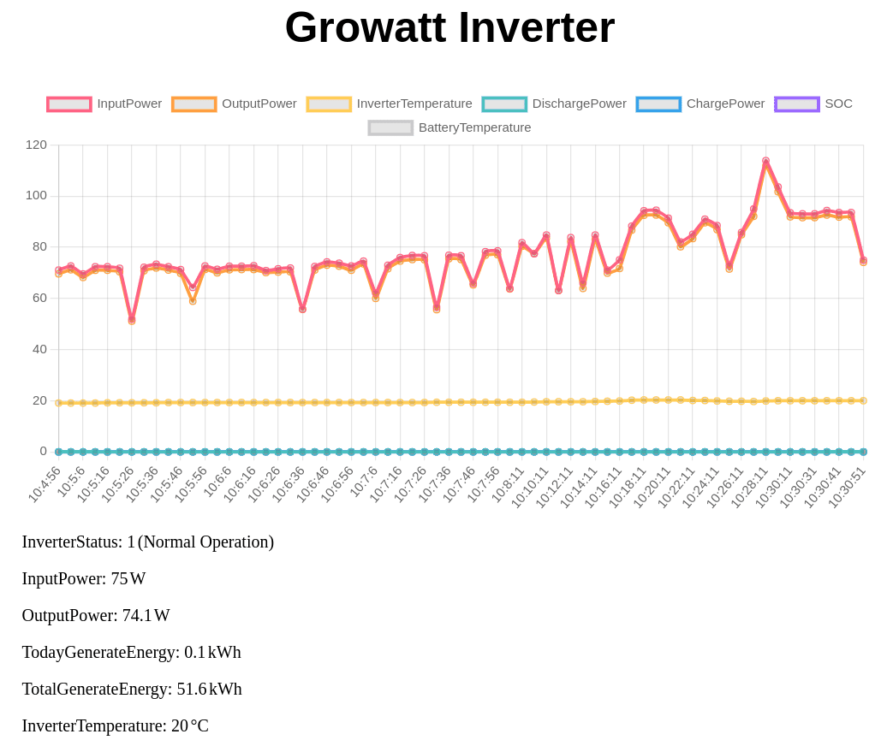

# OpenInverterGateway

Firmware replacement for Growatt ShineWiFi-S (serial), ShineWiFi-X (USB) or custom-built sticks (ESP8266/ESP32).

## Features

* Graphical UI using a built-in webserver with live visualization. [Screenshots](#screenshot).
* The inverter is queried using Modbus protocol.
* Inverter data is made available via
* The data received will be transmitted using MQTT to a server of your choice.
* The data received is also provided as JSON and Prometheus format
* Firmware update via [WifiManager](https://github.com/tzapu/WiFiManager)
* Basic access to arbitrary modbus data
* Tries to autodetect which stick type to use
* Configuration access point for initial configuration of Wifi and MQTT server ([IP, SSID, Password](#flashing--hardware))
* Supports Growatt protocol versions v1.20, v1.24 and v3.05
* Other Growatt protocol versions can easily be implemented / modified
* TLS support for ESP32
* Debugging via Web and Telnet
* Power limiting (allows zero export)
* Modbus TCP gateway: standard Modbus TCP access to the inverter over the network (port 502)

## Screenshot

<p align="center"></p>

## How to install

### Use the precompiled release

> [!IMPORTANT]
> The precompiled version will only work if your inverter uses version 1.24 of the
> Growatt Protocol ([here is why](SRC/ShineWiFi-ModBus/Config.h.example#L16)).
> You can start with it, but **you will likely need to compile OpenInverterGateway yourself**.

1. Download a [precompiled release from the GitHub release page](https://github.com/OpenInverterGateway/OpenInverterGateway/releases/)
   matching your hardware.
2. Follow the [flashing / hardware section below](#flashing--hardware).

### Compile a release yourself

1. Download / clone this repo.
2. Setup [PlatformIO](https://platformio.org/).
3. Open the project folder and choose the correct environment for your hardware by opening i.e.the **Project Tasks > ShineWiFiX** section.
4. Rename the [`Config.h.example`](SRC/ShineWiFi-ModBus/Config.h.example) to `Config.h` and adapt it according to your requirements.
5. Compile using the **Build** task from PlatformIO.
6. Follow the [flashing / hardware section below](#flashing--hardware).

### Flashing / Hardware

1. Flash the image to your hardware (ESP32 / ESP8266esp32 / ShineWifiX-S / ShineWifi-X / …). [Details on how to do this are provided in the documentation](/Doc/).
2. A configuration WiFi access point (SSID: `GrowattConfig`, Pass: `growsolar`) will be available.
   Connect to it and [configure the firmware via web interface at http://192.168.4.1](http://192.168.4.1).
3. If you need to reconfigure the stick, you have to either
   * Press the AP button on the front (configured with `ENABLE_AP_BUTTON` in `Config.h`)
   * Reset the stick twice within 2-10 seconds.

## Hardware compatability

* ShineWifi-S with a Growatt Inverter connected via serial (Modbus over RS232 with level shifter)
* ShineWifi-X with a Growatt Inverter connected via USB (USB-Serial Chip from Exar)
* Wemos-D1 with a Growatt Inverter connected via USB (USB-Serial Chip: CH340)
* NODEMCU V1 (ESP8266) with a Growatt Inverter connected via USB (USB-Serial Chip: CH340)
* ShineWifi-T (untested, please give feedback)
* Lolin32 (ESP32) with a Growatt Inverter connected via USB

I tested several ESP8266 boards with built-in USB-Serial converters.
So far, only boards with the CH340 chipset do work (CP21XX and FTDI chips do not work).
Almost all ESP8266 modules with added 9 pin serial port and level shifter should work with little soldering via serial.

Check out the [documentation for more details including pictures](Doc/).

### Caveats

* It does not make use the RTC or SPI Flash of these boards.
* It does not communicate to Growatt Cloud at all.
* The ShineLAN-X stick is not supported. However, there is [another project with support for that stick](https://github.com/mwalle/shinelanx-modbus).

## Supported Inverters

* Growatt 1000-3000S
* Growatt MIC 600-3300TL-X (Protocol 124 via USB/Protocol 120 via Serial)
* Growatt MID 3-25KTL3-X (Protocol 124 via USB)
* Growatt MOD 3-15KTL3-X-H (Protocol 120 via USB)
* Growatt MOD 12KTL3-X (Protocol 124 via USB)
* Growatt MID 25-40KTL3-X (Protocol 120 via USB)
* Growatt SPH 4000-10000STL3-X BH (Protocol 124 via Serial)
* Growatt MID 15KTL3-XH (Protocol 3000 via USB)
* And others …

## Modbus Protocol Versions

The documentation from Growatt on the Modbus interface is available, search for "Growatt PV Inverter Modbus RS485 RTU Protocol" on Google.

The older inverters apparently use Protocol v3.05 from year 2013.
The newer inverters apparently use protocol v1.05 from year 2018.
There is also a new protocol version v1.24 from 2020. (used with SPH4-10KTL3 BH-UP inverter)
TL-XH hybrid inverters use version v1.24 with a different set of input and holding registers.

## HTTP JSON Endpoint

For IoT applications, the raw data can be read in JSON format (`Content-Type: application/json`) by calling `http://<ip>/status`.

## Prometheus Scrape Endpoint

If you want to scrape the metrics with a Prometheus server, you can use the endpoint `http://<ip>/metrics`.
A possible configuration is described [in the documentation](Doc/Prometheus.md).

## [Home Assistant configuration](Doc/MQTT.md)

## Read / write arbitrary Modbus data

To make use of this feature, `#define ENABLE_MODBUS_COMMUNICATION 1` must be set in `Config.h` (default: `0`).
Then, once compiled and flashed, access `/postCommunicationModbus`.

## Modbus TCP gateway

With `#define MODBUS_TCP_SUPPORTED 1` in `Config.h` (default in `Config.h.example`) the stick acts as a
Modbus TCP to Modbus RTU gateway. Any standard Modbus TCP client (Home Assistant, evcc, Node-RED, pymodbus, mbpoll, ...)
can then talk to the inverter at `<ip>:502`. Each request is forwarded 1:1 to the inverter and the answer is sent back.

| Setting | Default | Description |
| --- | --- | --- |
| `MODBUS_TCP_PORT` | `502` | TCP port |
| `MODBUS_TCP_ALLOW_WRITE` | `0` | Allow FC 0x06 / 0x10 (write holding registers) |
| `MODBUS_TCP_MAX_CLIENTS` | `2` | Simultaneous connections; when full, the connection idle for the longest time is dropped |
| `MODBUS_TCP_ALLOWED_IP` | not set | Only accept connections from this IP |

* Supported function codes: `0x03` read holding registers, `0x04` read input registers (up to 125 registers per request),
  `0x06` / `0x10` write holding registers (up to 64 registers, only with `MODBUS_TCP_ALLOW_WRITE 1`).
* The unit id is ignored, requests always go to the inverter (Modbus address 1).
* Errors: inverter exceptions are passed through, no answer from the inverter results in exception `0x0B`
  (reads are retried once before), an undetected inverter in `0x0A`, unsupported or disabled function codes in `0x01`.
* Requests are handled in the main loop, so they never collide with the regular polling, MQTT or the web interface.
  The serial link is slow (9600 baud on the ShineWiFi-S), so don't poll faster than about once per second.
* Status (clients, requests, errors) is available at `http://<ip>/modbusTcp`.
* Modbus TCP has no authentication. Only use it in a trusted network.

Example:

```bash
mbpoll -m tcp -a 1 -t 3 -0 -r 0 -c 10 <ip>
```

## Debugging

There are several ways to debug OpenInverterGateway:

* Define `ENABLE_WEB_DEBUG` to enable a debug HTTP endpoint available at `http://<ip>/debug`.
* Define `ENABLE_TELNET_DEBUG` to enable a debug Telnet endpoint. Access using `telnet <IP_OF_OPEN_INVERTER_GATEWAY>`, i.e. `telnet 192.168.178.91`.
* Define `DEBUG_MODBUS_OUTPUT` to enable debug more for Modbus communication.

These values must be set in your `Config.h`.
Check [`Config.h.example`](./SRC/ShineWiFi-ModBus/Config.h.example) for examples.

## [Changelog](CHANGELOG.md)

## Acknowledgements

This project is based on [Jethro Kairys work on the Modbus interface](https://github.com/jkairys/growatt-esp8266).
